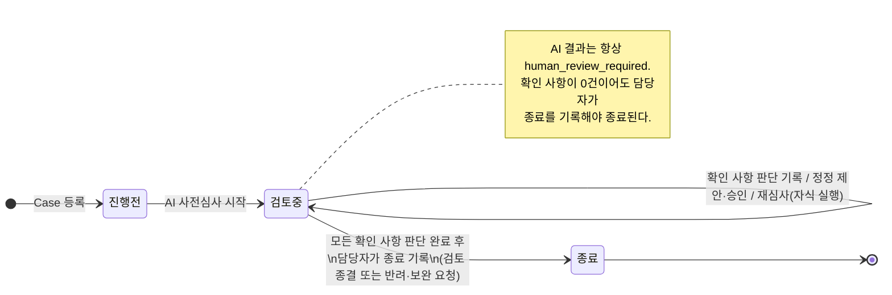
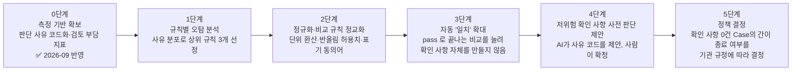

# 개발보고서 추가·수정안 — 2026-09-08 외부 피드백 반영

외부 검토자가 2026-09-08에 준 7개 피드백 중 **보고서 본문에 들어가야 할 내용**(1·2·3번)을 정리한 초안이다.
화면 개선(4·5·6·7번)은 코드에 반영했고, 이 문서의 4절이 그 변경을 보고서 문장으로 요약한다.
모든 다이어그램은 Mermaid 소스로 두어 그대로 렌더링하거나 보고서 도판으로 다시 그릴 수 있게 했다.

---

## 1. Validation 절차와 Validation Report (피드백 1번)

### 1.1 보고서에 추가할 절 — "검증(Validation) 절차"

AI 도구로 작성된 코드도 기업 도입 시에는 검증 절차를 거쳐야 한다. Customs-Fit은 검증을 다섯 계층으로 나누고,
각 계층을 **제품 저장소가 이미 소유한 자동 검사**로 수행한다. 새로 만든 검사가 아니라 저장소 CI와 같은 명령이므로,
검증 결과는 언제든 같은 명령으로 재현할 수 있다.

| 계층 | 이름 | 확인 내용 | 수행 도구 |
|---|---|---|---|
| L1 | 정적 검사·계약 | 형식·타입·경계 규칙, 공개 API(OpenAPI) 스냅샷이 저장소 기준과 바이트 단위로 같은지 | ruff · mypy · tsc · 경계 린트 · `verify_contract_snapshots.py` |
| L2 | 단위·제품 테스트 | 저장소별 자동 테스트 전부 통과 (Backend 336, Frontend 35, Agent 1,100+, Data 300+) | pytest · vitest |
| L3 | 저장소 간 계약 일치 | Frontend↔Backend, Backend↔Agent, Agent↔Data 계약 파일의 제공자·소비자 사본이 동일한지 | harness `check contract --cross` |
| L4 | 시나리오·Functional-UAT | 실제 Keycloak·Postgres·MinIO·Agent·Data·Claude 조합으로 심사 시나리오를 실행하고, 결과 코드·보고서 구조·한국어 문장 위생·비밀정보 미유출을 검증한 transcript 보존 | `run_functional_uat_matrix.py` · 장애 주입 매트릭스 · transcript verifier |
| L5 | 추출·OCR 정확도 Gold 평가 | 문서 추출 엔진이 사람 확정 Gold 세트를 통과한 경우에만 활성화(fail-closed) | Gold 평가·봉인 Gate (`R1_SUPERVISED_NATIVE_PDF_EVALUATION.md`) |

설계 원칙 두 가지를 함께 적는다.

- **Fail-closed.** 계약 불일치, 모델·패키지 드리프트, Gold 미통과는 모두 "기능 비활성"으로 끝나며 다른 엔진으로 우회하지 않는다.
- **자동 판단 없음.** 모든 심사 실행은 `human_review_required`로 기록되고, 검증은 "사람이 판단할 재료가 정확·재현 가능한가"를 확인하는 것이지 통관 판단의 정확성을 주장하지 않는다.

### 1.2 Validation Report

검증 기록은 `customs-engineering-harness`의 `validation_report` 명령이 생성한다.

```powershell
python -B harness/validation_report.py            # 4개 저장소 quick·contract 검사 실행 후 보고서 작성
python -B harness/validation_report.py --skip-run # 소스 식별·보유 증거만 기록
```

보고서는 (1) 검증 대상 커밋과 미커밋 변경 여부, (2) 검증 절차, (3) 계층별 실행 결과 표(PASS/FAIL·요약·소요),
(4) 저장소 간 계약 일치, (5) 보유 UAT transcript 수, (6) 추출 엔진 활성 상태와 Gold 평가 요약, (7) 제한 사항,
(8) 검토자·승인자 서명란으로 구성된다. 생성 결과는 `_artifacts/validation/validation-report-<날짜>.md`와 JSON 사이드카로 남는다.
보고서 부록에는 최신 생성본을 그대로 첨부한다.

---

## 2. 순서도 두 장 (피드백 2번)

### 2.1 Case 상태 전이도 — 시스템이 실제로 갖는 상태

검토자가 "진행 중에서 바로 종료로 넘어가는 건이 있는 것 아닌가"라고 읽은 것은 화면의 필터 라벨만 보고 생긴 오해다.
시스템의 Case 상태는 **세 개**뿐이고 전이는 **두 개**뿐이며, 자동 종료 경로는 없다.



| 상태 | 화면 라벨 | 의미 | 들어오는 전이 | 나가는 전이 |
|---|---|---|---|---|
| `open` | 진행 전 | Case·서류는 있으나 AI 심사 시작 전 | Case 등록 | 심사 시작 |
| `in_review` | 검토 중 | AI 사전심사 완료, 담당자 판단 대기·진행 | 심사 시작 | 담당자 종료 기록 |
| `closed` | 종료 | 담당자가 최종 처리 방향과 사유를 기록, 읽기 전용 | 담당자 종료 기록 | 없음 |

종료 조건은 Backend가 강제한다: 최신 심사 실행의 **모든 확인 사항에 담당자 판단이 기록**되어 있어야 종료 요청이 수락된다(`WorkbenchService.close_case`).
이 다이어그램은 심사 업무함·이용안내 화면에도 같은 내용으로 표시된다.

### 2.2 담당자 업무 처리 순서도 — 사용자 관점

```mermaid
flowchart TD
    A[1. Case 등록<br/>제목·참조번호] --> B[2. 서류 등록<br/>Invoice·Packing List·B/L·C/O 등<br/>추출 텍스트 확인, HSK 후보 확인]
    B --> C[3. AI 사전심사 실행<br/>문서 사실 추출 → 교차 검증 → 법령 근거 검색 → 보고서]
    C --> D{확인 사항이 있는가?}
    D -- 없음 --> G
    D -- 있음 --> E[4. 확인 사항별 판단 기록<br/>판단 상태 + 사전 정의 사유(또는 기타 직접 기재)]
    E --> F{문서 값 자체가 틀렸는가?}
    F -- 예 --> H[5. 정정 제안 → 다른 승인자 승인<br/>→ 자식 재심사 실행]
    H --> C
    F -- 아니오 --> G
    G[6. 심사 종료<br/>검토 종결 / 반려·보완 요청 + 종료 사유] --> Z([종료 · 읽기 전용])
    style C fill:#ecf2fe,stroke:#256ef4
    style E fill:#fdf1ee,stroke:#de3412
    style G fill:#eef8f0,stroke:#228738
```

각 단계가 만드는 상태 변화: 1 → 진행 전, 3 → 검토 중, 6 → 종료. 4·5는 검토 중 안에서의 반복이다.
이 순서도는 이용안내 화면의 "담당자 업무 순서"와 같다.

### 2.3 보고서 구성 제안

분량이 많아 내용 파악이 어렵다는 지적에 대해, 보고서 앞부분에 **한 쪽짜리 요약**을 두는 것을 제안한다.

1. 2.2 순서도(사용자 관점) 한 장
2. 2.1 상태 전이도 한 장
3. "AI가 하는 일 / 사람이 하는 일" 두 열 표 (아래)

| AI(제한형 Agent)가 하는 일 | 사람(담당자·승인자)이 하는 일 |
|---|---|
| 문서 유형 판별, 사실 추출, 값 정규화 | 추출 텍스트·HSK 후보 확인 |
| 문서 간 교차 검증, 불일치·검토 필요 항목 생성 | 확인 사항마다 판단 상태·사유 기록 |
| 법령·요건 근거 검색과 인용, 근거 기반 보고서 생성 | 정정 제안, 독립 승인, 재심사 실행 |
| (하지 않는 일) 자동 승인·자동 종료·원문 수정 | 최종 처리 방향 결정과 종료 기록 |

---

## 3. "검토 중"을 줄이는 점진적 개선 로드맵 (피드백 3번)

### 3.1 문제를 정확히 정의

현재 설계에서는 AI 심사를 거친 모든 Case가 검토 중이 되며, 이는 의도된 안전 장치다(자동 승인 금지).
따라서 "검토 중으로 넘어가는 건을 최소화"는 **자동 종료 도입**이 아니라 다음 두 지표를 줄이는 문제로 정의한다.

| 지표 | 정의 | 현재 집계 위치 |
|---|---|---|
| 확인 사항 발생률 | 최신 심사 실행에 확인 사항이 1건 이상 남은 Case 비율 | 운영 지표 › 검토 부담 분석 (`review_load.cases_with_findings`) |
| Case당 확인 사항 수 | 규칙(rule code)별 확인 사항 건수 분포 | 운영 지표 › 확인 사항이 많이 뜨는 규칙 (`review_load.findings_by_code`) |
| 오탐 비율 | 담당자가 "표기·단위·반올림 차이" 또는 "원본 대조 이상 없음"으로 닫은 확인 사항 비율 | 운영 지표 › 담당자 판단 사유 분포 (`review_load.decision_reason_codes`) |

이번 개선으로 **판단 사유를 코드화**했기 때문에 세 번째 지표를 처음으로 셀 수 있게 됐다. 어떤 규칙의 확인 사항이 대부분 "표기 차이"로 닫힌다면 그 규칙의 비교 로직이 느슨한 것이고, "보완 자료 요청"으로 닫힌다면 서류 자체의 문제이므로 개선 방향이 다르다.

### 3.2 단계별 로드맵



| 단계 | 내용 | 완료 기준 | 사람 검토 경계 |
|---|---|---|---|
| 0 | 판단 사유 코드(7종)와 검토 부담 지표 도입 | 운영 지표 화면에서 분포 확인 가능 | 변화 없음 |
| 1 | 3개월 운영 데이터로 규칙별 오탐 비율 산출 | 규칙별 "표기 차이" 비율 표 | 변화 없음 |
| 2 | 상위 오탐 규칙의 정규화 개선(단위 환산표, 반올림 허용치, 품명 동의어) | 해당 규칙 오탐 비율 절반 이하 | 변화 없음 (비교 결과만 정확해짐) |
| 3 | 개선된 규칙은 `pass`로 끝나 확인 사항을 만들지 않음 | Case당 확인 사항 수 감소 | 변화 없음 |
| 4 | AI가 과거 판단 사유 분포를 근거로 사유 코드를 **제안** | 담당자 클릭 수 감소 | 확정은 여전히 사람 |
| 5 | 확인 사항 0건 Case의 간이 종료(예: 확인 한 번으로 종료) 정책 검토 | 기관 규정·감사 요건 승인 | 정책으로만 완화, 코드 기본값은 유지 |

모든 단계에서 "AI 결과는 사람 검토 대상"이라는 계약(`human_review_required`, `CompletionEligibility.eligible = False`)은 코드에서 바뀌지 않는다. 5단계의 완화조차 기관이 정책으로 결정할 사항이며, 시스템은 그때까지 측정값을 쌓는 역할을 한다.

---

## 4. 화면 개선 요약 (피드백 4~7번, 코드 반영 완료)

| 번호 | 지적 | 반영 |
|---|---|---|
| 4 | 심사기록의 Case가 raw data처럼 보임 | 기준일을 날짜 형식으로, 내부 토큰(`human_review_required`) 문구 제거. 심사 이력에서 실행 UUID 대신 "N차 · 일시", 정정 제안은 "필드 한글명 → 값 / 파일명"으로 표시 |
| 5 | 업무함 Case를 상태별로 묶어 표시 | "전체" 탭에서 검토 중 → 진행 전 → 종료 순으로 그룹 헤더와 건수 표시. 개별 필터에서는 평면 목록 유지 |
| 6 | 확인 사항 내용 중복, 국·영문 혼용, 높음/보통 구분 불필요 | 규칙 코드를 한국어 제목으로 치환, 같은 문장이 카드·비교 상세·이어서 할 일에 세 번 나오던 것을 한 번으로, 심각도 배지 제거(정렬에만 사용), 영문 눈썹 문구·근거 유형·해시 라벨 한글화 |
| 7 | 판단 사유를 사전 정의 + 기타로 | 판단 사유 7종 코드(원본 대조 이상 없음 / 표기·단위 차이 / 보완 자료 요청 / 정정 제안 처리 / 법령 요건 충족 / 요건 미적용 / 기타)를 Backend 계약에 추가. 기타만 자유 기재 필수, 나머지는 추가 의견 선택. 사유 코드 분포가 운영 지표에 집계됨 |

관련 화면: 심사 업무함(상태 흐름·그룹 목록), 심사 워크스페이스 › 통관 심사(확인 사항 카드·판단 기록), 심사 기록, 심사 이력, 운영 지표(검토 부담 분석), 이용안내(상태 흐름·업무 순서).
